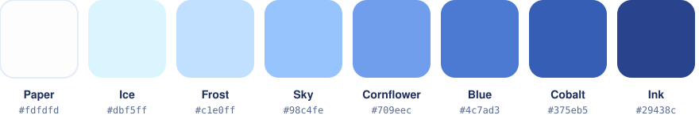
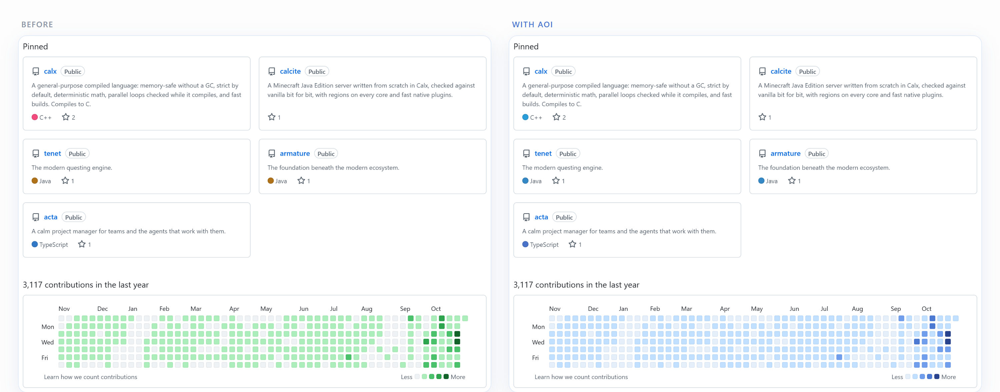
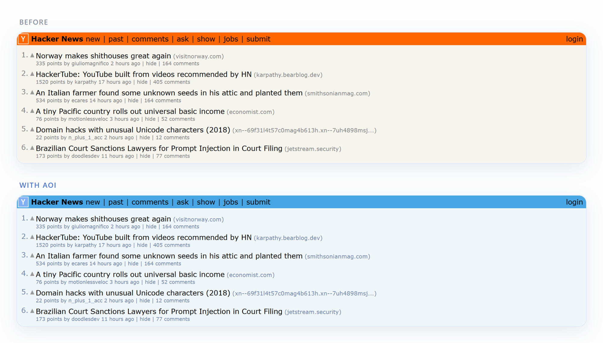
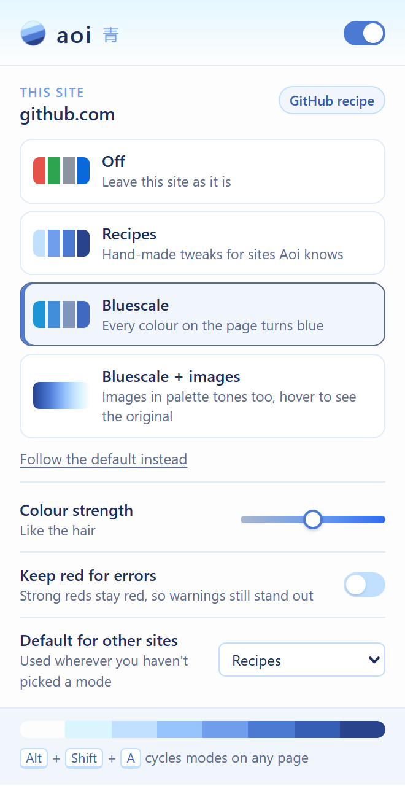

<p align="center">
  
</p>

<h1 align="center">aoi 青</h1>

<p align="center">
  A Chrome extension that turns the web white and bluescale.<br>
  Hand-made recipes for GitHub, YouTube and Gmail, and a bluescale mode for every other site.
</p>

<p align="center">
  
</p>

<br>





## Install

Aoi isn't on the Chrome Web Store, so you load it yourself. It takes about a minute.

1. **Get the code.** Either clone it:

   ```sh
   git clone https://github.com/ellipog/aoi.git
   ```

   or click **Code → Download ZIP** on this page and unzip it somewhere it can stay.

2. **Open the extensions page.** Go to `chrome://extensions` (or `edge://extensions`, `brave://extensions`).
3. **Turn on Developer mode** with the switch in the top-right corner.
4. **Click Load unpacked** and pick the `aoi` folder (the one with `manifest.json` in it).
5. **Pin it.** Click the puzzle-piece icon in the toolbar and pin Aoi.

Tabs that were already open need a reload before Aoi can recolour them.

**Updating:** run `git pull` (or download the ZIP again), then click the reload arrow on Aoi's card in `chrome://extensions`. Don't delete the folder while Aoi is installed, because Chrome loads it from there.

## Using it



Click the toolbar icon to choose a mode for the current site, or press <kbd>Alt</kbd>+<kbd>Shift</kbd>+<kbd>A</kbd> to cycle through them.

- **Off:** the site stays as it is.
- **Recipes:** hand-made tweaks for sites Aoi knows. This is the default everywhere.
- **Bluescale:** every colour on the page turns blue. Lightness is kept, so text stays readable. Greys become blue-greys and white stays white.
- **Bluescale + images:** images are tinted in palette tones too. Hover one to see the original.

**Colour strength** goes from soft to vivid. **Keep red for errors** leaves warnings red.

### Recipes

| Site | What turns blue |
|---|---|
| **GitHub** | Contribution graph, commit-activity bars, language colours, activity overview, primary buttons, tab underlines |
| **YouTube** | Progress bars, play-head, logo |
| **Gmail** | Labels: each one gets its own blue, the same in the inbox, conversations and the sidebar |

<br clear="right">

<details>
<summary><b>How it works</b></summary>

<br>

- **The palette** lives in [`src/shared/palette.js`](src/shared/palette.js). Everything else is derived from it.
- **Bluescale** works in OKLCH. It keeps each colour's lightness, moves the hue into the palette's blues, and caps the chroma at the palette's. Distinct colours stay distinct blues.
- **The engine** ([`src/content/engine.js`](src/content/engine.js)) rewrites colours inside the page's own CSS rules, so the cascade stays exactly as the site wrote it. It covers inline styles, SVG, shadow roots, CSS-in-JS and cross-origin stylesheets. Switching a site off restores it exactly.
- **Images** go through an SVG gradient-map filter built from the palette.

</details>

<details>
<summary><b>Adding a recipe</b></summary>

<br>

Create `src/recipes/<site>.js`, then add it to `content_scripts` in [`manifest.json`](manifest.json) and to the scripts in [`src/popup/popup.html`](src/popup/popup.html). Reload Aoi on `chrome://extensions`.

```js
(() => {
  const Aoi = (globalThis.Aoi ??= {});
  (Aoi.recipes ??= []).push({
    id: 'example',
    name: 'Example',
    description: 'What it changes',
    match: (host) => host === 'example.com',
    // palette colours are available as --aoi-paper, --aoi-ice, ... --aoi-ink
    css: `.brand-button { background: var(--aoi-blue) !important; }`,
    // optional, for colours that differ per element
    live: [
      { selector: '.tag-dot', recolor: ['background-color'] }, // run inline colours through bluescale
      { selector: '.tag', name: (el) => el.textContent, parts: [[null, 'chip']] }, // one blue per name
    ],
  });
})();
```

</details>

<details>
<summary><b>Known limits</b></summary>

<br>

- Chrome doesn't let extensions restyle `chrome://` pages or the Web Store.
- Videos, canvases and CSS background images aren't tinted.
- A page can flash its own colours for a moment while it loads.
- Gmail's class names are minified and change now and then. The label selectors are at the top of [`src/recipes/gmail.js`](src/recipes/gmail.js). Chips in an open conversation are matched on Gmail's English text, and in the sidebar only labels that already have a Gmail colour get recoloured.

</details>
